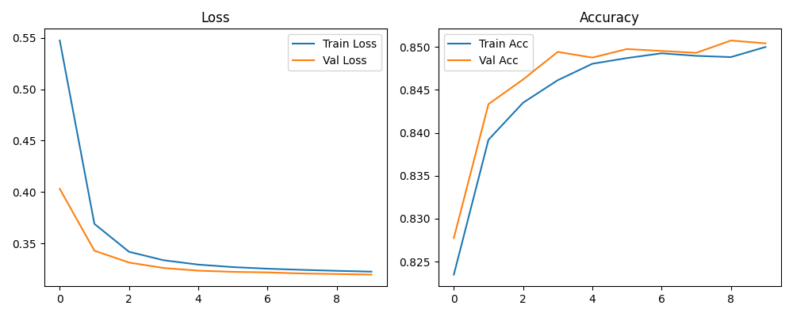
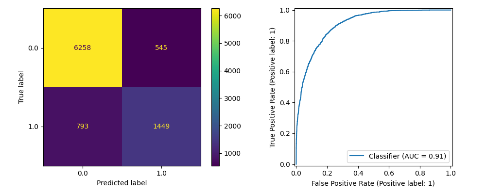
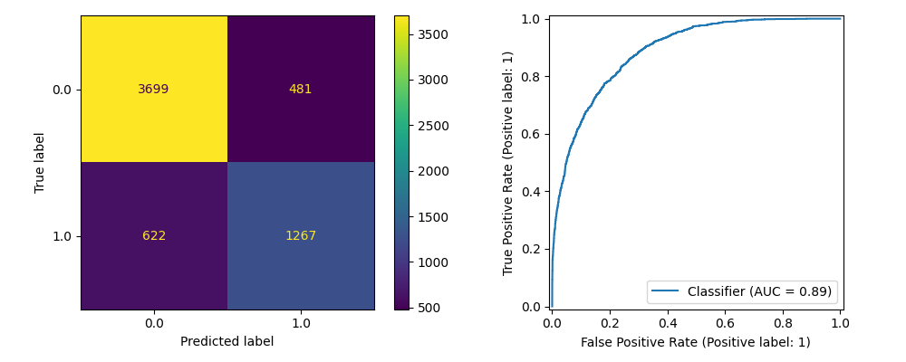
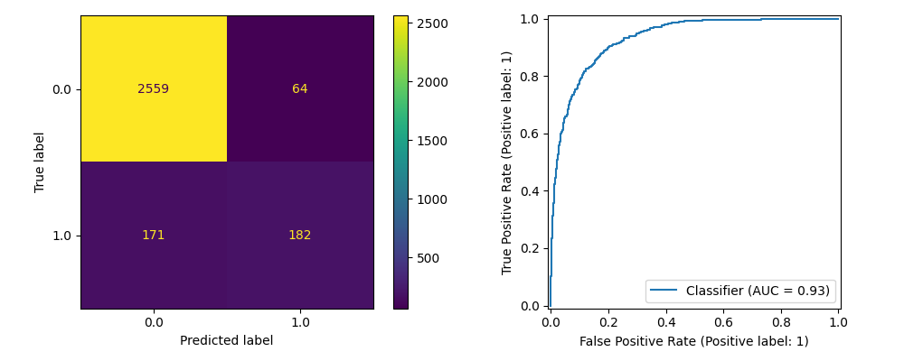

# Full Run Report

## Model Specifications
 - Architecture: small_mlp
 - Seed: 1
 - Method: erm
 - Epochs: 10
 - Patience: 5
 - Hidden Dimension: 64
 - Dropout: 0.0
 - Learning Rate: 0.0001

## Training History

## Metrics

### Total Combined Metrics
| Metric | Value |
|----------|----------|
| Accuracy | 0.8521 |
| ROC AUC | 0.9084
| Demographic Parity Difference | 0.2054 |
| Equal Opportunity Difference | 0.1551 |

## Confusion Matrix & ROC Curve

### Group 0 (Men) Metrics
| Metric | Value |
|----------|----------|
| Accuracy | 0.8183 |
| ROC AUC | 0.8872
| Advantaged TPR | 0.6707

## Confusion Matrix & ROC Curve

### Group 1 (Women) Metrics
| Metric | Value |
|----------|----------|
| Accuracy | 0.9210 |
| ROC AUC | 0.9319
| Advantaged TPR | 0.5156

## Confusion Matrix & ROC Curve

