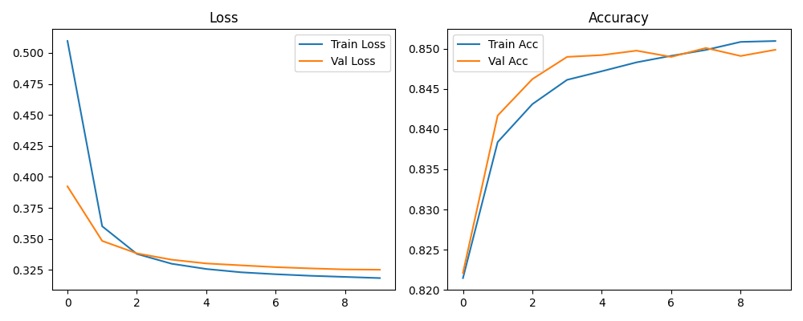
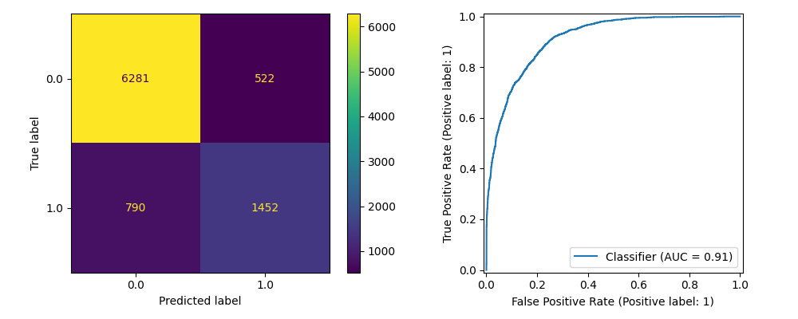
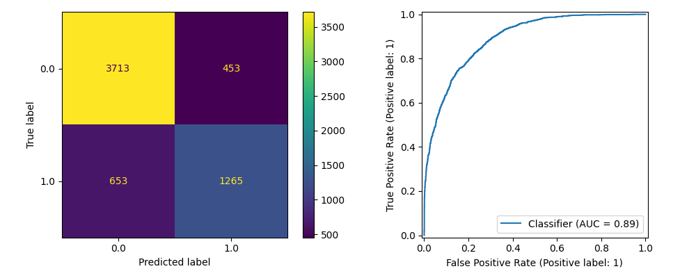
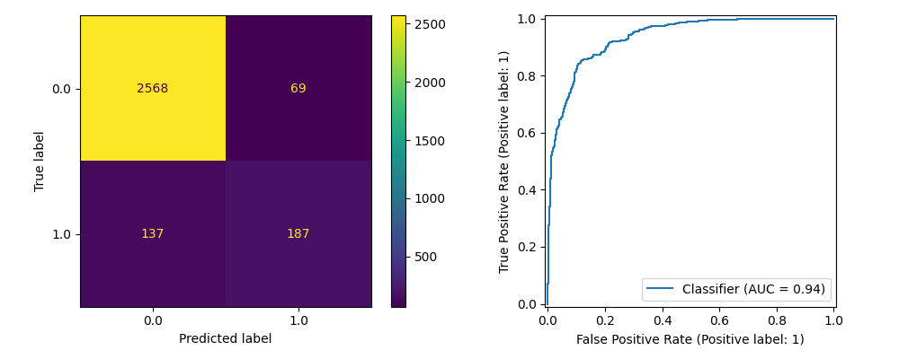

# Full Run Report

## Model Specifications
 - Architecture: small_mlp
 - Seed: 2
 - Method: erm
 - Epochs: 10
 - Patience: 5
 - Hidden Dimension: 64
 - Dropout: 0.0
 - Learning Rate: 0.0001

## Training History

## Metrics

### Total Combined Metrics
| Metric | Value |
|----------|----------|
| Accuracy | 0.8549 |
| ROC AUC | 0.9125
| Demographic Parity Difference | 0.1959 |
| Equal Opportunity Difference | 0.0824 |

## Confusion Matrix & ROC Curve

### Group 0 (Men) Metrics
| Metric | Value |
|----------|----------|
| Accuracy | 0.8182 |
| ROC AUC | 0.8900
| Advantaged TPR | 0.6595

## Confusion Matrix & ROC Curve

### Group 1 (Women) Metrics
| Metric | Value |
|----------|----------|
| Accuracy | 0.9304 |
| ROC AUC | 0.9363
| Advantaged TPR | 0.5772

## Confusion Matrix & ROC Curve

